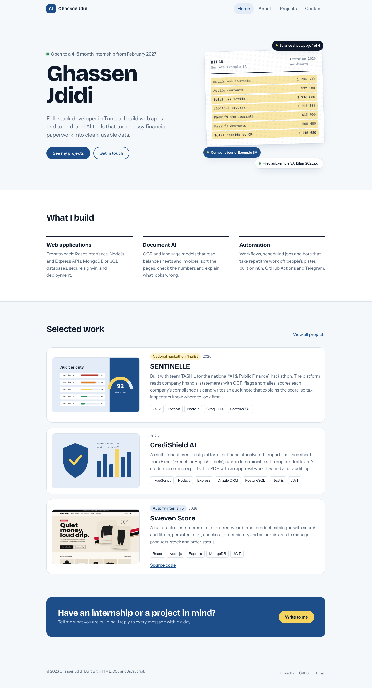

# Personal Portfolio Website

**Auspify Full Stack Development Internship, Task 1 (Easy)**
Ghassen Jdidi, November 2026

A responsive, multi-page portfolio that presents who I am, what I build, my projects and how to reach me. It is written in plain HTML, CSS and JavaScript, with no framework and no build step, so it loads fast and deploys anywhere.



## Features

| Auspify key feature | Where it is |
| --- | --- |
| Responsive design | Every page adapts from 1440 px down to 360 px. On phones the menu folds into a toggle and project cards stack. |
| Project showcase | `projects.html` lists 10 projects with a thumbnail, summary, tech stack and links. Visitors filter by type (internship, full-stack, AI, automation), and the filter is kept in the URL so it can be shared. |
| Contact form | `contact.html` validates every field as you type, blocks spam bots with a hidden honeypot field and sends messages through FormSubmit (no backend needed). If the service is unreachable, the visitor's email app opens with the message ready. |
| Professional UI | A clear type scale, one colour palette, visible keyboard focus, a skip link and a page-load animation that is switched off for people who prefer reduced motion. |

The home page opens with a small animation of a scanned balance sheet being read, highlighted and filed. It shows the kind of document-automation work I do, instead of a generic hero banner.

## Pages

- `index.html`: home (introduction, what I build, selected work, call to action)
- `about.html`: background, education and internship timeline, languages, certifications, skills
- `projects.html`: full project list with filters
- `contact.html`: contact details and form
- `404.html`: friendly page for broken links (used automatically by GitHub Pages and Netlify)

## Tech

HTML5, CSS3 (custom properties, grid, flexbox, media queries), vanilla JavaScript (ES2020). Fonts are self-hosted (Bricolage Grotesque, Instrument Sans, IBM Plex Mono), so the site makes no requests to Google and works offline.

## Project structure

```
Task1-Portfolio-Website/
├── index.html, about.html, projects.html, contact.html, 404.html
├── assets/
│   ├── css/style.css          design tokens, layout, components, responsive rules
│   ├── css/fonts.css          self-hosted font declarations
│   ├── js/projects-data.js    the project list (edit this file to add a project)
│   ├── js/main.js             menu, hero animation, project rendering and filters, contact form
│   ├── fonts/                 woff2 font files
│   └── img/                   favicon and project thumbnails
└── screenshots/
```

## Run it locally

No install needed. Open `index.html` in a browser, or serve the folder to get clean relative paths:

```bash
cd Task1-Portfolio-Website
python -m http.server 8080      # or: npx serve .
# open http://localhost:8080
```

## Deploy (free)

**GitHub Pages**

1. Create a public repository named `ghazzen007.github.io` (or any name).
2. Push the contents of this folder to the `main` branch.
3. In the repository, go to Settings, then Pages, choose "Deploy from a branch", branch `main`, folder `/ (root)`, and save.
4. The site goes live at `https://ghazzen007.github.io/` (or `https://ghazzen007.github.io/<repo-name>/`) within a minute or two.

**Netlify (drag and drop)**: go to app.netlify.com/drop and drop this folder.

**Contact form activation**: the first message sent through the live site triggers a confirmation email from FormSubmit to ghassen.jdidi04@gmail.com. Click the link in that email once, and every later message arrives normally.

## How the Auspify workflow was followed

1. **Design the website layout**: tokens for colour and type in `style.css`, one layout grid shared by all pages.
2. **Create Home, About, Projects and Contact pages**: four HTML pages with a shared header and footer.
3. **Implement responsive design**: mobile-first rules with breakpoints at 960 px and 720 px, tested at 1440 px and 390 px (see `screenshots/`).
4. **Add project showcase section**: data-driven list in `projects-data.js`, rendered and filtered by `main.js`.
5. **Deploy the website**: steps above. Add the live link to the internship submission.

## Screenshots

| File | Shows |
| --- | --- |
| `01-home.png` | Home page, desktop |
| `02-about.png` | About page with timeline and skills |
| `03-projects-filtered.png` | Projects filtered to the internship projects |
| `04-contact-validation.png` | Contact form showing validation messages |
| `05-mobile-home.png`, `06-mobile-menu.png`, `07-mobile-projects.png` | Phone layout and open menu |
